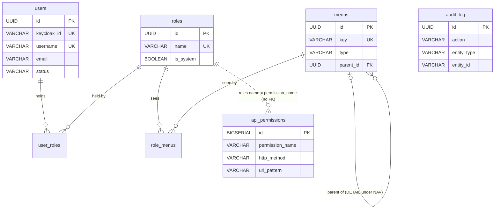

# cce-admin-service — Data Dictionary

> **Compared with the team's data dictionary on 2026-11-19 (D14).** PRD B-01 / B-02 say the tables
> and the 12-menu seed must match the team's data dictionary. The team's version arrived as Jay's
> design docs (openphc/cce-admin-service PR #1) and was compared column by column on 2026-11-19.
> This document stays the source for S2: its tables and the menus from `cce-insights-ui` are kept,
> and one index was taken from Jay's version (`role_menus(menu_id)`). Differences and reasons are
> in SPEC §9.

## 1. Database Tables

Database `admin_service`, created by Flyway `db/migration/V1__schema.sql` (S2). Flyway keeps its
history in `flyway_schema_history_admin`. On a shared database that already has tables (servers), it
starts that history at version 0, so V1 and V2 both run (§7.2).

### 1.1 Conventions

| Rule | Detail |
|------|--------|
| **Primary keys** | UUID, default `gen_random_uuid()` (`CREATE EXTENSION IF NOT EXISTS pgcrypto`). Exception: `api_permissions.id` is `BIGSERIAL` (D1) |
| **Timestamps** | `TIMESTAMPTZ`. Exception: `api_permissions` keeps the gateway's own column types (D2) |
| **Foreign keys** | No `ON DELETE CASCADE`. The service deletes child rows itself, in a known order (D10) |
| **`api_permissions`** | `CREATE TABLE IF NOT EXISTS`, gateway shape, never altered, no index added (D1, D2) |
| **Nullability** | A column is `NOT NULL` unless marked "null" below |

### 1.2 `users`

A local copy of each person who can log in; 1:1 with a Keycloak user.

| Column | Type | Null | Default | Description |
|--------|------|------|---------|-------------|
| `id` | UUID | No | `gen_random_uuid()` | Primary key |
| `keycloak_id` | VARCHAR(36) | No | — | Keycloak user id = JWT `sub` |
| `username` | VARCHAR(255) | No | — | Login name, lowercase (as Keycloak stores it; S8). Never changes (S9 rule e) |
| `email` | VARCHAR(255) | No | — | Unique case-insensitively |
| `first_name` | VARCHAR(255) | Yes | — | Required by the API on create and update (S8/S9 rule g); nullable in the DB |
| `last_name` | VARCHAR(255) | Yes | — | Same as `first_name` |
| `status` | VARCHAR(20) | No | — | `ACTIVE` / `INACTIVE` / `LOCKED` (§3) |
| `facility_scope` | TEXT | Yes | — | Stored and shown only, not enforced (PRD) |
| `last_login_at` | TIMESTAMPTZ | Yes | — | From the token's `auth_time` (D7). A login moves only this column, never `updated_at` |
| `created_at` | TIMESTAMPTZ | No | `now()` | |
| `updated_at` | TIMESTAMPTZ | No | `now()` | Set by the service on each change |

**Constraints & indexes:** `keycloak_id` unique · `username` unique · unique on `lower(email)` ·
CHECK `status IN ('ACTIVE','INACTIVE','LOCKED')`.

### 1.3 `roles`

| Column | Type | Null | Default | Description |
|--------|------|------|---------|-------------|
| `id` | UUID | No | `gen_random_uuid()` | Primary key |
| `name` | VARCHAR(100) | No | — | UPPER_SNAKE_CASE. = Keycloak realm role = `api_permissions.permission_name`. Never changes (D9) |
| `display_name` | VARCHAR(255) | No | — | Editable |
| `description` | TEXT | Yes | — | Editable |
| `is_system` | BOOLEAN | No | `false` | `true` only for `SUPER_ADMIN`; system roles can't be changed or deleted |
| `created_at` | TIMESTAMPTZ | No | `now()` | |
| `updated_at` | TIMESTAMPTZ | No | `now()` | Set by the service on each change |

**Constraints & indexes:** `name` unique · CHECK `name ~ '^[A-Z][A-Z0-9_]*$'`. Length 100 fits
both `api_permissions.permission_name` widths seen (100 in the gateway doc, 255 in the server seed).

### 1.4 `menus`

The catalog of `cce-insights-ui` screens.

| Column | Type | Null | Default | Description |
|--------|------|------|---------|-------------|
| `id` | UUID | No | `gen_random_uuid()` | Primary key |
| `key` | VARCHAR(100) | No | — | Stable id consoles map screens by. Never changes (S5 rule a) |
| `label` | VARCHAR(255) | No | — | Text shown in the sidebar |
| `path` | VARCHAR(512) | No | — | Console route, e.g. `/compliance/patients/:id` |
| `icon` | VARCHAR(100) | Yes | — | Heroicon name, e.g. `ChartBarIcon` |
| `type` | VARCHAR(10) | No | — | `NAV` / `DETAIL` (§3) |
| `parent_id` | UUID | Yes | — | → `menus.id`. Null for NAV; a NAV for DETAIL |
| `sort_order` | INT | No | — | Order in the sidebar |
| `is_active` | BOOLEAN | No | `true` | Inactive menus are hidden by `/me/menus` |
| `created_at` | TIMESTAMPTZ | No | `now()` | |
| `updated_at` | TIMESTAMPTZ | No | `now()` | Set by the service on each change |

**Constraints & indexes:** `key` unique · CHECK `type IN ('NAV','DETAIL')` · FK `parent_id` →
`menus`. "NAV has no parent, DETAIL has a NAV parent" is checked by the service (S5 rule b).

### 1.5 `role_menus`

Which role sees which menu (soft control).

| Column | Type | Null | Default | Description |
|--------|------|------|---------|-------------|
| `role_id` | UUID | No | — | → `roles.id` |
| `menu_id` | UUID | No | — | → `menus.id` |
| `created_at` | TIMESTAMPTZ | No | `now()` | |

**Constraints & indexes:** PK (`role_id`, `menu_id`) · index on `menu_id` (finding a menu's rows
when it is deleted, S5; the PK only helps lookups that start with `role_id`).

### 1.6 `user_roles`

Which user holds which role. Kept when a user is deactivated or locked, so re-activation restores
access (B-34).

| Column | Type | Null | Default | Description |
|--------|------|------|---------|-------------|
| `user_id` | UUID | No | — | → `users.id` |
| `role_id` | UUID | No | — | → `roles.id` |
| `created_at` | TIMESTAMPTZ | No | `now()` | |

**Constraints & indexes:** PK (`user_id`, `role_id`) · index on `role_id` (the D10 `ROLE_IN_USE`
check).

### 1.7 `api_permissions`

Which role may call which API (hard control). **Shape owned by gateway-service**, which reads it
with R2DBC. Created only if missing; column widths copy the server seed
`deploy-scripts/k8s/seeds/api_permissions.sql` (D2).

| Column | Type | Null | Default | Description |
|--------|------|------|---------|-------------|
| `id` | BIGSERIAL | No | sequence | Primary key; `Long` in our JPA entity (D1) |
| `permission_name` | VARCHAR(255) | No | — | = `roles.name` for our rows (D11). Other values (e.g. `COLLECTOR_EVENTS_WRITE`) belong to others and are never touched |
| `http_method` | VARCHAR(10) | No | — | `GET` / `POST` / `PUT` / `PATCH` / `DELETE` (§3) |
| `uri_pattern` | VARCHAR(512) | No | — | Ant-style pattern, e.g. `/admin/v1/**` |
| `description` | TEXT | Yes | — | |
| `resource_category` | VARCHAR(255) | Yes | — | |
| `created_at` | TIMESTAMP (no time zone) | No | `now()` | Same as the server seed (D2) |
| `updated_at` | TIMESTAMP (no time zone) | No | `now()` | Same as the server seed (D2) |

**Constraints & indexes:** none added by us. The gateway's migration doc has
`UNIQUE (permission_name, http_method, uri_pattern)` but the server seed doesn't; we follow the
seed (D2 notes). Duplicates are prevented by the service (S11 rule b).

Every role always has at least one row, `GET /admin/v1/me/menus` (D4, D6).

New environment: run the gateway seed before this service starts for the first time. The seed
inserts fixed ids 1–15 and skips ids already taken, so after our V2 it would silently drop its own
first 5 rows (SPEC D2).

### 1.8 `audit_log`

Append-only history (B-50). Append-only is enforced in code: the repository has no update or
delete method (S4).

| Column | Type | Null | Default | Description |
|--------|------|------|---------|-------------|
| `id` | UUID | No | `gen_random_uuid()` | Primary key |
| `actor_id` | UUID | Yes | — | `users.id` of the caller; null for `SYSTEM` |
| `actor_username` | VARCHAR(255) | No | — | Caller's username, or `SYSTEM` at startup (D5) |
| `action` | VARCHAR(50) | No | — | §9.2 |
| `entity_type` | VARCHAR(50) | No | — | `USER` (S2a), `MENU` (S5), `ROLE` (S6) |
| `entity_id` | VARCHAR(64) | No | — | Id of the changed row (string, so it can hold any id) |
| `before` | JSONB | Yes | — | State before; null on create |
| `after` | JSONB | Yes | — | State after; null on delete. Failure details for `*_FAILED` (§9.3) |
| `ip_address` | VARCHAR(45) | Yes | — | First `X-Forwarded-For` entry, trimmed; no header, or an entry that is blank or longer than 45 characters → the remote address; null outside a request |
| `created_at` | TIMESTAMPTZ | No | `now()` | |

**Constraints & indexes:** no FKs (so failure rows and `SYSTEM` rows never break on a missing
user) · index (`entity_type`, `entity_id`) · index `created_at`.

### 1.9 Relationships



`api_permissions` is joined to `roles` by **name**, not by id (D11), which is why mixing a
`BIGSERIAL` id with UUIDs elsewhere is safe (D1). `audit_log` has no relationships by design.

## 2. Seed Data

Flyway `db/migration/V2__seed.sql` (S2), the same in every environment. Flyway runs it once per
database; the `api_permissions` rows are also inserted with `WHERE NOT EXISTS`, so a table that
already exists on a server keeps its rows and gets the SUPER_ADMIN rows once.

### 2.1 Menus (12)

10 NAV from `cce-insights-ui` `src/components/layout/Sidebar.tsx` + 2 DETAIL from its `:id`
drill-down routes (D14). `/events/source-comparison` is not seeded.

| Key | Label | Path | Type | Parent | `sort_order` | Icon |
|-----|-------|------|------|--------|--------------|------|
| `dashboard` | Dashboard | `/` | NAV | — | 10 | `ChartBarIcon` |
| `compliance` | Compliance | `/compliance` | NAV | — | 20 | `ClipboardDocumentCheckIcon` |
| `facilities` | Facilities | `/facilities` | NAV | — | 30 | `BuildingOffice2Icon` |
| `practitioners` | Practitioners | `/practitioners` | NAV | — | 40 | `UserGroupIcon` |
| `deviations` | Deviations | `/deviations` | NAV | — | 50 | `ExclamationTriangleIcon` |
| `patients` | Patients | `/compliance/patients` | NAV | — | 60 | `ClipboardDocumentCheckIcon` |
| `intelligence` | Intelligence | `/intelligence` | NAV | — | 70 | `BoltIcon` |
| `events` | Events | `/events` | NAV | — | 80 | `SignalIcon` |
| `ingestion` | Ingestion | `/ingestion` | NAV | — | 90 | `CogIcon` |
| `exports` | Exports | `/exports` | NAV | — | 100 | `ArrowDownTrayIcon` |
| `protocol-detail` | Protocol analytics | `/compliance/protocols/:id` | DETAIL | `compliance` | 21 | — |
| `patient-detail` | Patient detail | `/compliance/patients/:id` | DETAIL | `patients` | 61 | — |

Keys not fixed by the SPEC follow the path (`/facilities` → `facilities`). DETAIL labels are named
after their pages in `cce-insights-ui` (`ProtocolAnalytics`, `PatientDetail`); they have no icon,
since they have no sidebar entry, and their `sort_order` comes right after the parent's.

Patients is its own top-level NAV, as B-02 requires. All 12 are `is_active = true`.

### 2.2 Roles (1)

| `name` | `display_name` | `description` | `is_system` | Menus |
|--------|----------------|---------------|-------------|-------|
| `SUPER_ADMIN` | Super Admin | Full access to the admin API. | `true` | none — an admin-console role; the admin UI sidebar is static (S2) |

### 2.3 API permissions (5)

| `permission_name` | `http_method` | `uri_pattern` | `description` | `resource_category` |
|-------------------|---------------|---------------|---------------|---------------------|
| `SUPER_ADMIN` | `GET` | `/admin/v1/**` | Read admin resources | Admin |
| `SUPER_ADMIN` | `POST` | `/admin/v1/**` | Create admin resources | Admin |
| `SUPER_ADMIN` | `PUT` | `/admin/v1/**` | Replace admin resources | Admin |
| `SUPER_ADMIN` | `PATCH` | `/admin/v1/**` | Update admin resources | Admin |
| `SUPER_ADMIN` | `DELETE` | `/admin/v1/**` | Delete admin resources | Admin |

`id`, `created_at` and `updated_at` come from the table's defaults. The `GET` row also covers
`GET /admin/v1/me/menus` (D6).

### 2.4 Rows written at startup (not Flyway)

`BootstrapAdminRunner` (S2a, D5) links the first admin once per environment, in one transaction:

| Table | Row |
|-------|-----|
| `users` | `keycloak_id` = the Keycloak id of `BOOTSTRAP_ADMIN_USERNAME`; username, email, names from Keycloak; `ACTIVE` |
| `user_roles` | → `SUPER_ADMIN` |
| `audit_log` | `actor_username` `SYSTEM`, action `BOOTSTRAP_ADMIN_LINKED`, `entity_type` `USER`, `entity_id` = `users.id` |

## 3. Allowed Values

| Field | Values / pattern | Source |
|-------|------------------|--------|
| User `status` | `ACTIVE`, `INACTIVE`, `LOCKED`. INACTIVE and LOCKED both disable the Keycloak account; only the label differs | B-34, S10 rule a |
| Menu `type` | `NAV` (sidebar item), `DETAIL` (drill-down under a NAV) | B-02 |
| Permission `httpMethod` | `GET`, `POST`, `PUT`, `PATCH`, `DELETE` | S11 rule a |
| Role `name` | `^[A-Z][A-Z0-9_]*$`, max 100 | S2 |
| Menu `key` | `^[a-z][a-z0-9-]*$` | S5 rule e |
| Permission `uriPattern` | Starts with `/`, max 512, Ant-style | S11 rule a |

## 4. Request Models

Field rules are enforced before anything is written; a failure is 400 `VALIDATION_ERROR`. Endpoint
behaviour: [API Reference](api-reference.md).

### 4.1 CreateUserRequest — `POST /users` (S8)

| Field | Type | Required | Rule |
|-------|------|----------|------|
| `username` | String | Yes | Trimmed and lowercased first; 3–255; not in `users` (409 `USERNAME_IN_USE`) |
| `email` | String | Yes | Trimmed and lowercased first; valid email; max 255; not in `users` in any case (409 `EMAIL_IN_USE`) |
| `firstName` | String | Yes | Not blank; max 255 (S8 rule g) |
| `lastName` | String | Yes | Not blank; max 255 (S8 rule g) |
| `facilityScope` | String | No | |
| `roleIds` | List\<UUID\> | Yes | At least one; no `null` item; each must exist; repeats count once |

Trimming and lowercasing happen in the record's constructor, so the checks see the cleaned values.
A `password` field is ignored and never sent to Keycloak (B-36): the record has no such field.

### 4.2 UpdateUserRequest — `PUT /users/{id}` (S9)

The whole profile (S9 rule g).

| Field | Type | Required | Rule |
|-------|------|----------|------|
| `firstName` | String | Yes | Not blank |
| `lastName` | String | Yes | Not blank |
| `email` | String | Yes | Not blank; not used by another user |
| `facilityScope` | String | No | `null` clears it |
| `username` | String | No | Must equal the current username if present |

### 4.3 User status and roles bodies (S10)

DTO names confirmed in S10.

| Endpoint | Field | Type | Rule |
|----------|-------|------|------|
| `PATCH /users/{id}/status` | `status` | String | §3; not the caller's own status |
| `PUT /users/{id}/roles` | `roleIds` | List\<UUID\> | Full set; at least one; each must exist; not the caller's own roles |

### 4.4 CreateRoleRequest / UpdateRoleRequest — `/roles` (S6)

| Field | Create | Update | Rule |
|-------|--------|--------|------|
| `name` | Required | Optional | Create: §3 pattern, max 100, unused as role name and as `permission_name`. Update: must equal the current name (D9) |
| `displayName` | Required | Required | Not blank, max 255 |
| `description` | Optional | Optional | No limit; blank = none. Update: left out = none |
| `isSystem` | Ignored | Ignored | Created roles are always `is_system = false` |

`PUT` sends the complete editable part; the same values as now write nothing and no audit row.

### 4.5 RoleMenusRequest — `PUT /roles/{id}/menus` (S7)

| Field | Type | Rule |
|-------|------|------|
| `menuIds` | List\<UUID\> | Required (missing → 400); full set; may be empty; no `null` items; duplicates count once; each must exist |

### 4.6 RolePermissionsRequest / PermissionRow — `PUT /roles/{id}/permissions` (S11)

| Field | Type | Required | Rule |
|-------|------|----------|------|
| `permissions` | List\<PermissionRow\> | Yes | Not empty; must contain a `GET` row matching `/admin/v1/me/menus` (D4, D6) |
| `permissions[].httpMethod` | String | Yes | §3 |
| `permissions[].uriPattern` | String | Yes | §3 |
| `permissions[].description` | String | No | |
| `permissions[].resourceCategory` | String | No | |

A `permissionName` in a row is ignored; rows are stored under the role's own name (D11).

### 4.7 MenuRequest — `POST /menus`, `PUT /menus/{id}` (S5)

| Field | Type | Required | Rule |
|-------|------|----------|------|
| `key` | String | Yes | §3 pattern, max 100; unique; on `PUT` must equal the current key |
| `label` | String | Yes | Not blank, max 255 |
| `path` | String | Yes | Not blank, max 512 |
| `type` | String | Yes | §3 |
| `parentId` | UUID | DETAIL only | NAV: none. DETAIL: an existing NAV, not itself. Left out on `PUT` = none |
| `icon` | String | No | Max 100; blank = no icon. Left out on `PUT` = none |
| `sortOrder` | Integer | Yes | Ties are ordered by `key` |
| `isActive` | Boolean | `POST`: no (missing = `true`). `PUT`: yes | |

`PUT` sends the complete menu; the same values as now write nothing and no audit row.

### 4.8 Query parameters

| Param | Type | Used by | Rule |
|-------|------|---------|------|
| `page` | int | `GET /users`, `GET /roles` | From 1, default 1 (`PageParams`, S1) |
| `pageSize` | int | `GET /users`, `GET /roles` | Default 20, max 100 |
| `q` | String | `GET /users` | Case-insensitive contains on username, firstName, lastName, email |
| `status` | String | `GET /users` | §3 |
| `roleId` | UUID | `GET /users` | Users holding that role |
| `facilityScope` | String | `GET /users` | Exact match |

## 5. Request Context

### 5.1 CurrentUser (S3)

Built by `ActiveUserFilter` on every authenticated request and kept on the request; read it with
`CurrentUser.get(request)` (`null` on open paths, where no checks run).

| Field | Type | Source |
|-------|------|--------|
| `id` | UUID | `users.id` of the row whose `keycloak_id` = token `sub` |
| `username` | String | `users.username` |
| `roles` | List\<String\> | From the token at `JWT_ROLES_CLAIM_PATH`; empty if the claim is missing |

Used as the audit actor and for "not your own status / roles" (S10 rule c). `/me` and `/me/menus`
do **not** use these token roles; they read `user_roles` (S12).

### 5.2 Token claims read

| Claim | Use |
|-------|-----|
| `sub` | Finds the local user (`users.keycloak_id`) |
| `iss` | Must equal `JWT_ISSUER` |
| `aud` | Must contain `JWT_AUDIENCE` |
| `exp` | Must be in the future |
| `auth_time` | Moves `users.last_login_at` forward when newer (D7), with an UPDATE of that column only. Missing → unchanged, one INFO line per app start |
| roles at `JWT_ROLES_CLAIM_PATH` | `CurrentUser.roles` (default `realm_access.roles`) |

## 6. Response Models

### 6.1 Envelope (S1)

| Model | Fields |
|-------|--------|
| `ApiResponse<T>` | `data` (T); `pagination` (only on paginated lists) |
| `Pagination` | `page` (int), `pageSize` (int), `total` (long) |
| `ErrorResponse` | `error.code` (String, an `ErrorCode`), `error.message` (String) |
| Health body (not enveloped) | `status` (`UP`), `db` (`UP` / `DOWN`) |

### 6.2 Resource models

| Model | Fields | Sub-task |
|-------|--------|----------|
| `UserResponse` | `id`, `username`, `email`, `firstName`, `lastName`, `status`, `roles` (`[{id, name, displayName}]`), `facilityScope`, `lastLoginAt`, `createdAt` | S9 rule d |
| `CreatedUserResponse` | `id`, `username`, `email`, `status`, `roles` (List\<UserRoleItem\>, A→Z by name); the 201 body of `POST /users` | S8 |
| `UserRoleItem` | `id`, `name`, `displayName` (one role of a user) | S8 |
| `RoleResponse` | `id`, `name`, `displayName`, `description`, `isSystem`, `createdAt`, `updatedAt` | S6 |
| `MenuResponse` | `id`, `key`, `label`, `path`, `icon`, `type`, `parentId`, `sortOrder`, `isActive`, `children` (List\<MenuResponse\>; `[]` for a DETAIL and in the `POST`/`PUT` reply) | S5 |
| `RoleMenuItem` | `id`, `key`, `label`, `type`, `parentId` (one item of `GET /roles/{id}/menus` and of `RoleMenusResponse.menus`) | S7 |
| `RoleMenusResponse` | `menus` (List\<RoleMenuItem\>, sidebar order: `sortOrder`, then `key`), `warnings` (List\<String\>, one per DETAIL without its NAV parent) | S7 |
| `PermissionRow` | `id` (Long), `httpMethod`, `uriPattern`, `description`, `resourceCategory` | S11 |
| `MeResponse` | `id`, `username`, `email`, `firstName`, `lastName`, `roles` (sorted names), `facilityScope` | S12 rule a |
| `MenuNode` | `id`, `key`, `label`, `path`, `icon`, `type`, `children` | S12 rule d |

## 7. Configuration Properties

Rule (B-13): `application.yml` holds only environment-neutral defaults; every `localhost` value is
in `application-local.yml`, used only with `SPRING_PROFILES_ACTIVE=local`. Elsewhere a required
variable with no value stops startup. YAML key names are confirmed in the sub-task listed.

### 7.1 Server and profile

| Env var | Default | Local value | Required outside local | Sub-task |
|---------|---------|-------------|------------------------|----------|
| `SERVER_PORT` | `8085` | — | No | S1 |
| `SPRING_PROFILES_ACTIVE` | — | `local` | — (not `local`) | S1 |

### 7.2 Database

| Env var | Default | Local value | Required outside local | Sub-task |
|---------|---------|-------------|------------------------|----------|
| `DB_URL` | — | `jdbc:postgresql://localhost:5434/admin_service` | Yes | S1 |
| `DB_USERNAME` | — | `admin_service` | Yes | S1 |
| `DB_PASSWORD` | — | `POSTGRES_PASSWORD` from `.env` (secret; `application-local.yml` reads `.env` itself) | Yes | S1 |

YAML keys: `spring.datasource.url` / `username` / `password`. Outside `local`, a missing or empty
one stops startup with `Missing required setting(s): DB_URL, …` (`RequiredSettingsCheck`).

Connection pool timeouts, fixed in `application.yml` (no env var), so a database outage is
answered in about 2 seconds instead of Hikari's default 30:

| Key | Value |
|-----|-------|
| `spring.datasource.hikari.connection-timeout` | `2000` ms |
| `spring.datasource.hikari.validation-timeout` | `1000` ms |

Flyway, fixed in `application.yml` (no env var). The same pattern as the other CCE services that
share `ccedb` (e.g. matcher, protocol): that database is never empty, and each service keeps its own history.

| Key | Value | Why |
|-----|-------|-----|
| `spring.flyway.baseline-on-migrate` | `true` | A database with tables but no history of ours is started, not refused |
| `spring.flyway.baseline-version` | `0` | Nothing of ours counts as applied, so V1 and V2 both run (the default, 1, would skip V1) |
| `spring.flyway.table` | `flyway_schema_history_admin` | Own history, apart from the other services' |

### 7.3 JWT

| Env var | Default | Local value | Required outside local | Sub-task |
|---------|---------|-------------|------------------------|----------|
| `JWT_ISSUER` | — | `http://localhost:8180/realms/cce` | Yes | S3 |
| `JWT_AUDIENCE` | — | `cce-admin-service` | Yes | S3 |
| `JWT_JWK_SET_URI` | `${JWT_ISSUER}/protocol/openid-connect/certs` | — | No | S3 |
| `JWT_ROLES_CLAIM_PATH` | `realm_access.roles` | — | No | S3 |

`JWT_ISSUER`, `JWT_AUDIENCE` and `JWT_ROLES_CLAIM_PATH` must match the gateway's values for the
same realm (PRD §9). Local values were read from a real token (README, 2026-11-12).

YAML keys: `spring.security.oauth2.resourceserver.jwt.issuer-uri` / `audiences` / `jwk-set-uri`
(Spring Boot's own settings, which also check `aud`) and `cce.jwt.roles-claim-path`. Keycloak's public keys are
fetched on the first token, not at startup, so the service starts while Keycloak is down. Locally,
`application-local.yml` sets `JWT_ISSUER` and `JWT_AUDIENCE` themselves, since `jwk-set-uri` is built
from `JWT_ISSUER`. Outside `local`, a missing or empty `JWT_ISSUER` / `JWT_AUDIENCE` stops startup
(`RequiredSettingsCheck`).

### 7.4 Keycloak Admin API

| Env var | Default | Local value | Required outside local | Sub-task |
|---------|---------|-------------|------------------------|----------|
| `KEYCLOAK_BASE_URL` | — | `http://localhost:8180` (in `application-local.yml`) | Yes | S2a |
| `KEYCLOAK_REALM` | `cce` | — | No | S2a |
| `KEYCLOAK_CLIENT_ID` | `cce-admin-service` | — | No | S2a |
| `KEYCLOAK_CLIENT_SECRET` | — | — (secret; from `.env`) | Yes | S2a |

Timeout: 10s to connect and 10s to answer (fixed, `KeycloakAdminClient.TIMEOUT`). A missing
`KEYCLOAK_BASE_URL` or `KEYCLOAK_CLIENT_SECRET` stops startup, naming it (`RequiredSettingsCheck`);
Keycloak being down does not (D5).

### 7.5 Gateway

| Env var | Default | Local value | Required outside local | Sub-task |
|---------|---------|-------------|------------------------|----------|
| `GATEWAY_BASE_URL` | — | `http://localhost:8095` (in `application-local.yml`) | Yes | S6a |

Timeout: 10s to connect and 10s to answer (fixed, D3; `HttpGatewaySyncClient.TIMEOUT`). A missing
`GATEWAY_BASE_URL` stops startup, naming it (`RequiredSettingsCheck`); the gateway being down does
not (each sync that needs it answers 502).

### 7.6 Bootstrap admin

| Env var | Default | Local value | Required | Sub-task |
|---------|---------|-------------|----------|----------|
| `BOOTSTRAP_ADMIN_USERNAME` | — (unset → bootstrap does nothing) | `superadmin` (in `application-local.yml`) | No | S2a |

The only bootstrap setting: no id, email or password in config (D5). It is trimmed and lowercased
when read, as Keycloak stores usernames in lowercase, so `SuperAdmin` works the same as `superadmin`.

### 7.7 Local `.env` (S0)

Read by `docker-compose.yml` and the scripts in `local/`; gitignored, template in `.env.example`.

| Variable | Used by | Meaning |
|----------|---------|---------|
| `POSTGRES_DB` | Postgres | Database name, `admin_service` |
| `POSTGRES_USER` / `POSTGRES_PASSWORD` | Postgres | Database login |
| `KEYCLOAK_ADMIN_USER` / `KEYCLOAK_ADMIN_PASSWORD` | Keycloak | Admin console login (realm `master`) |
| `SUPERADMIN_PASSWORD` | `create-superadmin.sh`, `get-token.sh` | Password of the test user `superadmin` |
| `KEYCLOAK_CLIENT_SECRET` | Keycloak realm import (and the service, S2a) | Secret of client `cce-admin-service` |

## 8. External Models

### 8.1 Gateway sync response (D3)

`POST /api/permissions/sync-to-keycloak` on gateway-service. Fields we read:

| Status | `success` | Other fields | Meaning |
|--------|-----------|--------------|---------|
| 200 | `true` | — | All done → success |
| 206 | `false` | `failedRoles` (list of role names) | Rules reloaded in gateway memory, some Keycloak roles failed → failure |
| 500 | `false` | `message` | Exception (DB read or Keycloak) → failure |
| 200 | — | "No permissions found in database" | Table empty; can't happen while the SUPER_ADMIN seed rows exist |

The gateway also reports a `deletedCount` (D4); we don't use it. Any reply other than 200 +
`success:true` is a failure (D3).

### 8.2 KeycloakUser (S2a)

Our record for a user read from Keycloak.

| Field | Type | Note |
|-------|------|------|
| `id` | String | Becomes `users.keycloak_id` |
| `username` | String | |
| `email` | String | Bootstrap refuses a user without one (`users.email` is NOT NULL) |
| `firstName` | String | |
| `lastName` | String | |

### 8.3 What the service creates in Keycloak

| Object | Content | Sub-task |
|--------|---------|----------|
| User | `username`, `email`, `firstName`, `lastName`; `enabled = true`; required action `UPDATE_PASSWORD`; **no credentials** | S8 |
| Realm-role mappings | Add / remove realm roles named like our roles; picked from the user's available realm roles (S8) | S8, S10 |
| Enabled flag | `false` for INACTIVE / LOCKED, `true` for ACTIVE | S10 |

Realm roles themselves are created and deleted by the gateway's sync, never by this service (D4).

## 9. Audit Actions Reference

### 9.1 Row content

| Field | Rule |
|-------|------|
| Actor | `CurrentUser`; no request (startup) → `actor_username = SYSTEM`, `actor_id = null` |
| IP | First `X-Forwarded-For` entry, trimmed; no header, or an entry that is blank or longer than 45 characters → remote address (a faked header never fails the change); null outside a request |
| `before` / `after` | JSON; never contain passwords or secrets |
| Count | Exactly one row per change, in the change's transaction (`AuditWriter.record`, MANDATORY) |

### 9.2 Actions

| Action | Written by | `before` | `after` |
|--------|------------|----------|---------|
| `BOOTSTRAP_ADMIN_LINKED` | Startup (S2a) | null | `keycloakId`, `username`, `email`, `firstName`, `lastName`, `status` (`ACTIVE`), `roles` (`["SUPER_ADMIN"]`) |
| `MENU_CREATED` | `POST /menus` (S5) | null | the menu: `id`, `key`, `label`, `path`, `icon`, `type`, `parentId`, `sortOrder`, `isActive` |
| `MENU_UPDATED` | `PUT /menus/{id}` (S5); not written when nothing changed | the menu (as above) | the menu (as above) |
| `MENU_DELETED` | `DELETE /menus/{id}` (S5) | `{menu: <as above>, roleIds: [ids of the roles that had it, sorted]}` | null |
| `ROLE_CREATED` | `POST /roles` (S6) | null | `{role: <the role>, permissions: [the GET /admin/v1/me/menus row]}`; the role = `id`, `name`, `displayName`, `description`, `isSystem`; a row = `id`, `httpMethod`, `uriPattern`, `description`, `resourceCategory` |
| `ROLE_UPDATED` | `PUT /roles/{id}` (S6); not written when nothing changed | the role (as above) | the role (as above) |
| `ROLE_DELETED` | `DELETE /roles/{id}` (S6) | `{role, menus: [menu keys, A–Z], permissions: [its rows]}` | null |
| `ROLE_MENUS_UPDATED` | `PUT /roles/{id}/menus` (S7); not written when nothing changed | `{menus: [menu keys, A–Z]}` | `{menus: [menu keys, A–Z]}` |
| `ROLE_PERMISSIONS_UPDATED` | `PUT /roles/{id}/permissions` (S11) | the rows | the rows (shows what was added and removed) |
| `USER_CREATED` | `POST /users` (S8) | null | `id`, `keycloakId`, `username`, `email`, `firstName`, `lastName`, `status` (`ACTIVE`), `facilityScope`, `roles` (names A–Z) — the `BOOTSTRAP_ADMIN_LINKED` shape plus `id` and `facilityScope` (`UserSnapshot`) |
| `USER_UPDATED` | `PUT /users/{id}` (S9) | profile | profile |
| `USER_ACTIVATED` | `PATCH …/status` (S10) | confirmed in S10 | confirmed in S10 |
| `USER_DEACTIVATED` | `PATCH …/status` (S10) | confirmed in S10 | confirmed in S10 |
| `USER_LOCKED` | `PATCH …/status` (S10) | confirmed in S10 | confirmed in S10 |
| `USER_ROLES_UPDATED` | `PUT …/roles` (S10) | role names | role names |
| `USER_PASSWORD_RESET` | `POST …/reset-password` (S10) | confirmed in S10 | confirmed in S10 |

Requests that change nothing (same set, same status, `POST /roles/{id}/sync`) write no row.

### 9.3 Failure actions (D8)

Written by `AuditWriter.recordFailure` in **its own transaction** (`REQUIRES_NEW`), so they
survive the main rollback. `recordFailure` logs the ERROR line (§10) before it writes the row, and
never throws; if the row can't be written (insert or commit), a second ERROR line says so and the
first one is the record. `before` is null.

| Action | Written by |
|--------|------------|
| `USER_CREATE_FAILED` | `POST /users` (S8) |
| `USER_UPDATE_FAILED` | `PUT /users/{id}` (S9) |
| `USER_STATUS_UPDATE_FAILED` | `PATCH /users/{id}/status` (S10) |
| `USER_ROLES_UPDATE_FAILED` | `PUT /users/{id}/roles` (S10) |

`after` JSON:

| Field | Meaning | Example |
|-------|---------|---------|
| `keycloakId` | The Keycloak user involved | `3f9c…` |
| `failedStep` | Step that failed | `assign realm roles`, `save user` |
| `error` | The error | |
| `cleanup` | What was done about it | `keycloak user deleted` / `FAILED — delete keycloak user <id> by hand` |

`entity_id` of a `USER_CREATE_FAILED` row is the **username** (no `users.id` exists: the save
rolled back), so an operator can search `WHERE entity_id = 'alice'`; the ERROR line shows it too.
`failedStep` is `assign realm roles` or `save user`.

## 10. Log Fields

Fields the log lines carry:

| Log line | Fields |
|----------|--------|
| ERROR on a 500 (D12) | `ref` = 8-character reference id (also in the response `message`), method + path, full exception |
| WARN on a gateway sync failure (D3) | `Gateway sync failed for role <id>: POST <url> → status=<status>, body=<full body>`; when the gateway never answered: `status=none, body=none, error=could not connect` or `error=no answer within 10s` |
| WARN when Keycloak could not create a user (S8) | `User <username> not created: Keycloak at <url>: could not create user <username>: <reason>` — nothing half done, so no ERROR and no audit row |
| ERROR on a half-done Keycloak/DB change (D8) | Written by `AuditWriter.recordFailure`: `<action> <entityType> <entityId>: keycloakId=…, failedStep=…, error=…, cleanup=…`; if the audit row can't be written, a second line `Audit row for <action> <entityType> <entityId> not written; the line above is the only record` with the exception |

Metrics and MDC fields are **not in v1**. The log format is Spring Boot's default console format,
unchanged:

```
2026-11-21T00:45:18.816+05:30  INFO 90307 --- [cce-admin-service] [           main] o.s.b.w.embedded.tomcat.TomcatWebServer  : Tomcat started on port 8085 (http) with context path '/'
<timestamp>                    <level> <pid>  [application name]  [thread]              <logger>                                 : <message>
```

The 500 line reads `ERROR … GlobalExceptionHandler : [ref=7f3a9c2e] GET /admin/v1/… failed`,
followed by the stack trace.
