# cce-admin-service — Flow Diagrams

All diagrams use Mermaid notation. Colours: green = success, orange = saved but needs a follow-up
(or nothing to do), red = error.

## 1. End-to-End Flow

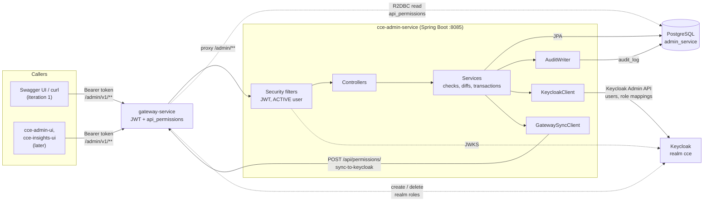

The gateway and the service share one table, `api_permissions`: the service writes its roles'
rows, the gateway reads them on startup and on every sync.

## 2. Request Processing Sequence

One authenticated request, e.g. `PUT /admin/v1/roles/{id}` (S3, S4, D7).

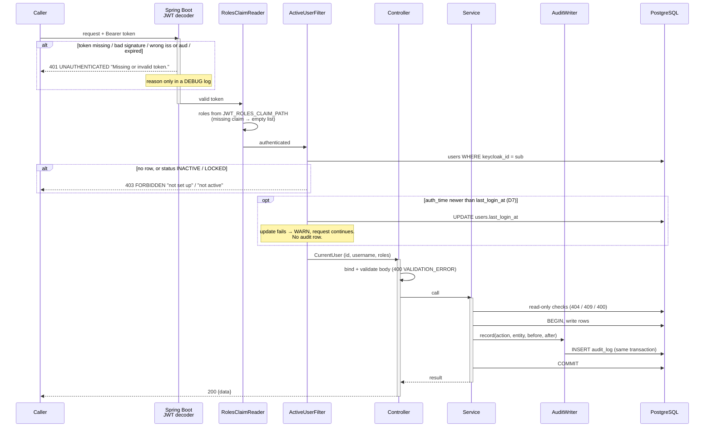

## 3. Create User with Undo

`POST /admin/v1/users` (S8, D8). Keycloak never sees the request until the DB checks pass.

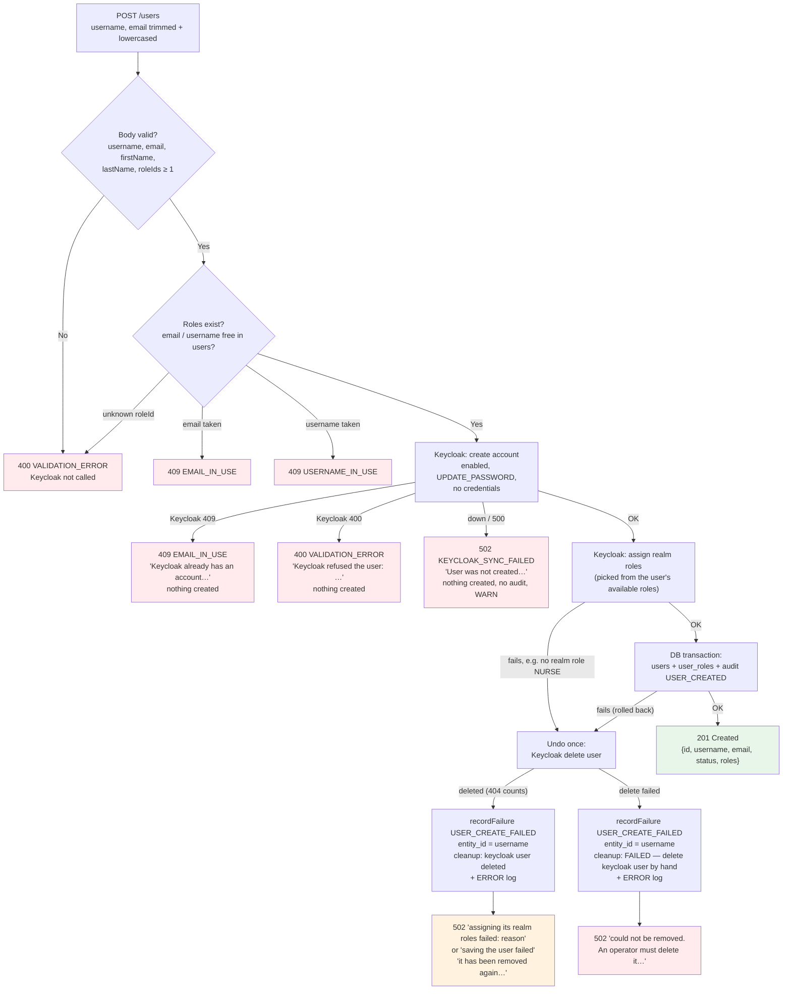

Each Keycloak call is made at most once; nothing is retried (B-32). `recordFailure` always logs an ERROR
line, then writes the audit row in its own transaction, so the row survives the rollback; if even
that fails (insert or commit), it logs a second ERROR line and never throws, so the first line is
the record (S4).

## 4. Gateway Sync Handling

`GatewaySyncClient.sync(roleId)` (S6a, D3). Called after the DB commit by `POST /roles`,
`DELETE /roles/{id}`, `PUT /roles/{id}/permissions` and `POST /roles/{id}/sync`.

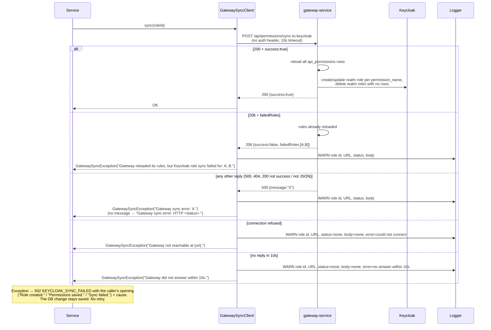

Sync is **global**: the gateway reloads every row, so a 206 may come from another role's rows.

## 5. Error Handling Flow

D12: every error, planned or not, leaves as `{error:{code,message}}`.

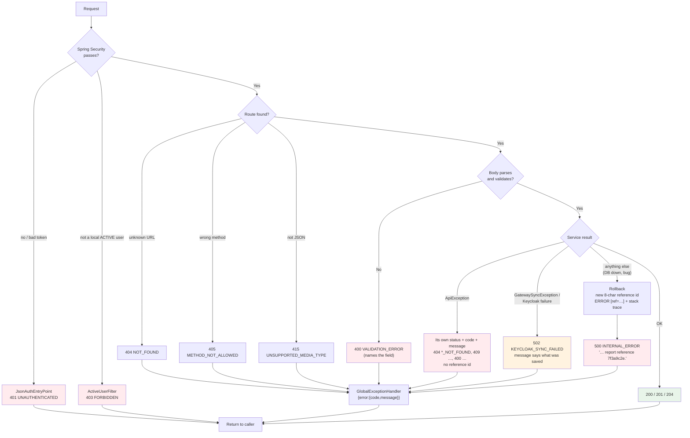

No exception text, SQL, stack trace, host or class name ever goes into `message`.

## 6. Component Dependency Graph

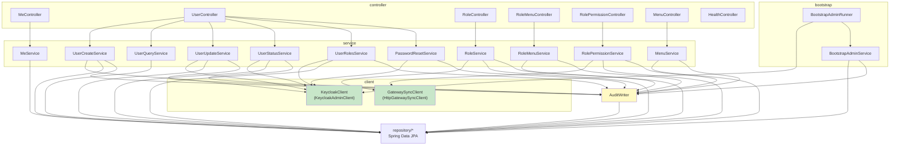

`KeycloakClient` and `GatewaySyncClient` are interfaces, so service tests swap in fakes and can
test "Keycloak worked, DB failed" without a real Keycloak (ARCHITECTURE.md §7).

## 7. Deployment Topology

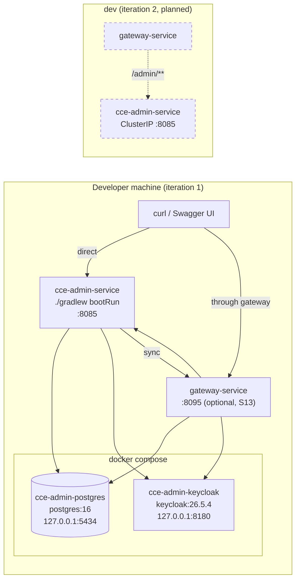

Without the local gateway, every sync returns 502 "Gateway not reachable…" while the DB change is
kept; that is expected locally.

## 8. Create a Role

`POST /admin/v1/roles` (S6, D4, D11).

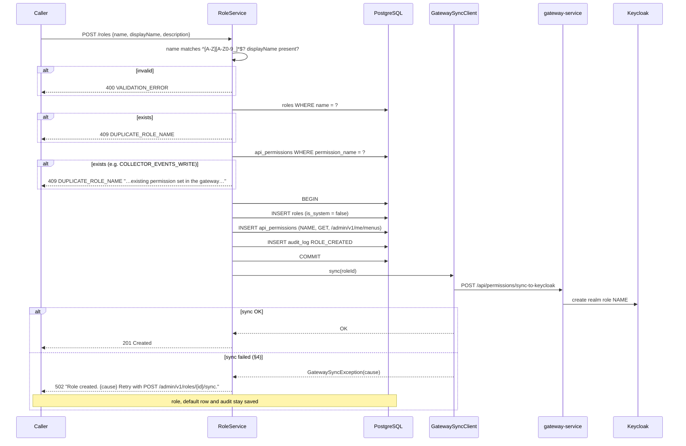

Because of the default row, the realm role exists in Keycloak from the moment the role is created,
so the role can be given to a user straight away (D4; PRD §9 "Ordering").

## 9. Save a Role's Permissions

`PUT /admin/v1/roles/{id}/permissions` (S11). Nothing is written before step 6.

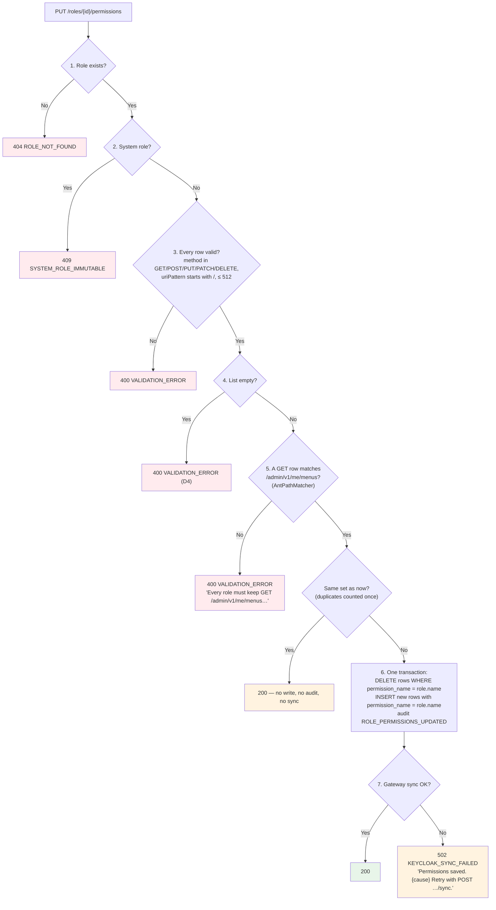

`permission_name` always comes from the role in the URL, never from the body, and rows of other
permission sets are never touched (D11).

## 10. Delete a Role

`DELETE /admin/v1/roles/{id}` (D10).

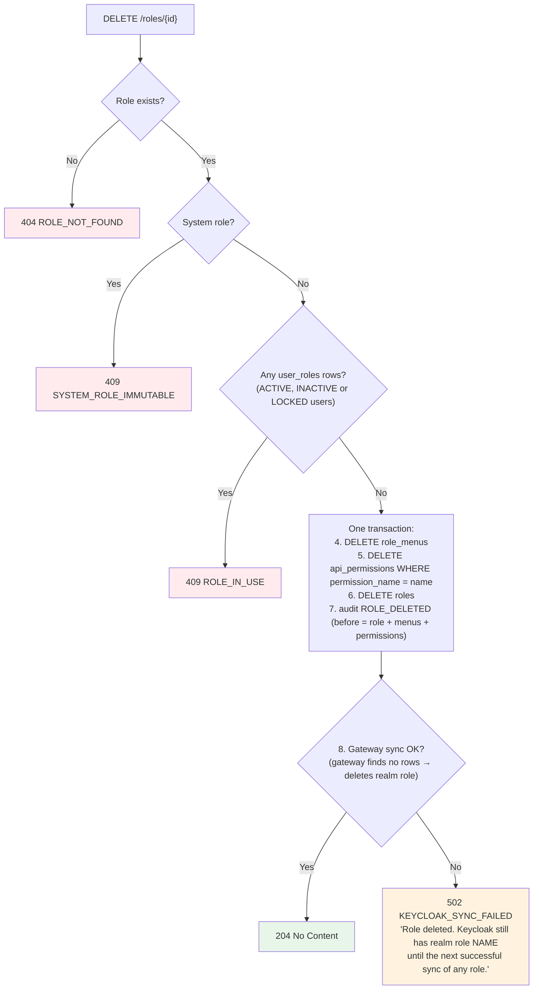

After a failed sync, `POST /roles/{id}/sync` can't be used (the role is gone, 404); the next
successful sync of any role removes the leftover realm role (D10 option a).

## 11. Change Status / Roles

`PATCH /users/{id}/status` and `PUT /users/{id}/roles` (S10, D8). Keycloak is called inside the
open DB transaction.

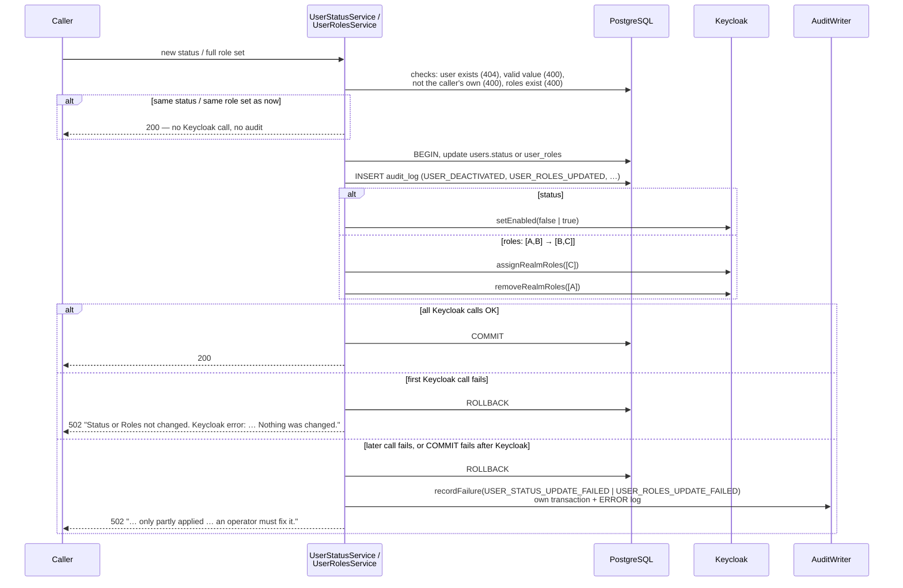

No undo here: reverting could overwrite something that changed in the meantime, so a person fixes
it (D8). Deactivation keeps `user_roles`, so re-activation restores the same access (B-34).
`PUT /users/{id}` (S9) follows the same order with one Keycloak call, `updateUser`, made only when
the email or a name changed; the same values return 200 before the transaction writes anything. A
taken email is found at the row write (flush), before Keycloak. When our side fails after Keycloak
took the change, `USER_UPDATE_FAILED` is recorded with `cleanup` = `none — make Keycloak match the
user record by hand`.

## 12. Bootstrap Admin at Startup

`BootstrapAdminRunner`, after Flyway, on every start (D5, S2a). It never stops the service: any
other failure (e.g. the database) is an ERROR with its stack trace, and nothing is saved. The
username is lowercased first, as Keycloak stores it.

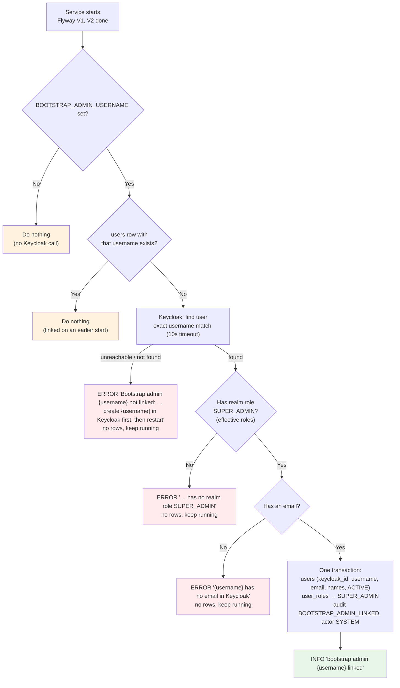

The fix for any ERROR is to create or correct the user in Keycloak and restart the service. Until
the admin is linked, their valid token gets 403 `FORBIDDEN` (B-12).

## 13. Building `/me/menus`

`GET /admin/v1/me/menus` (S12, B-21). Read-only; no audit, no Keycloak call.

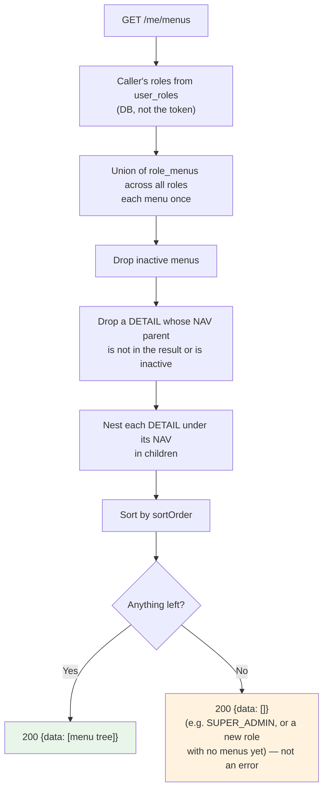

Roles come from the DB so a role change shows on the caller's next request with the same token,
whichever claim path the token uses (S12, D13).
